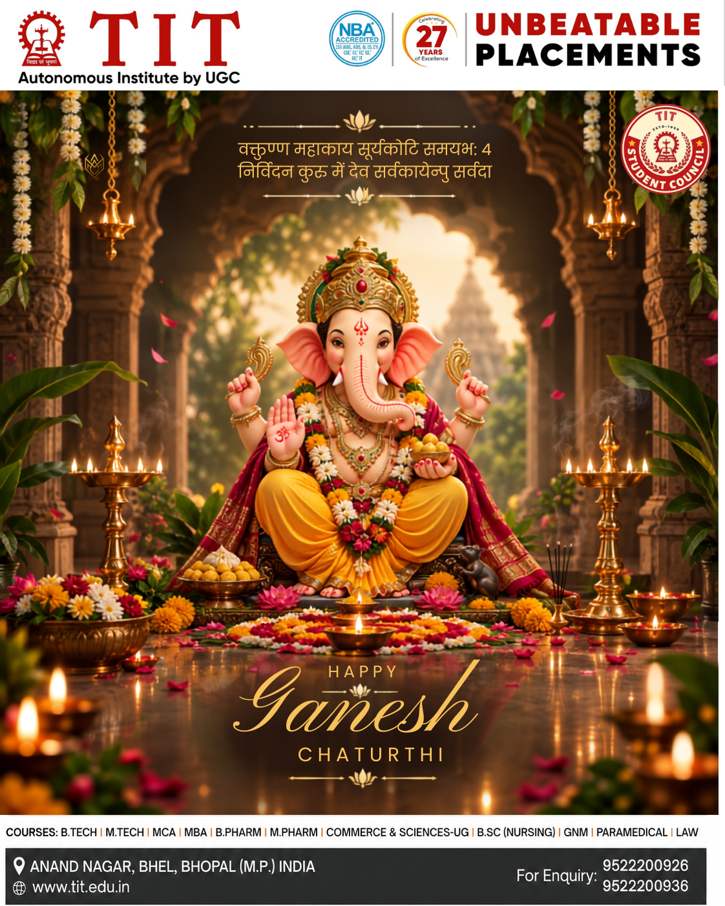
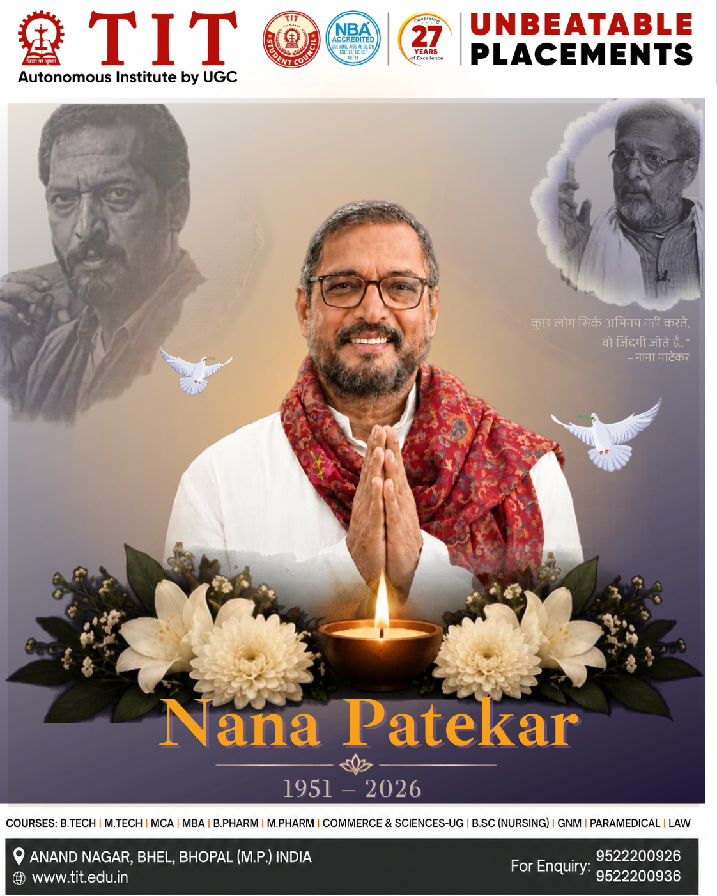
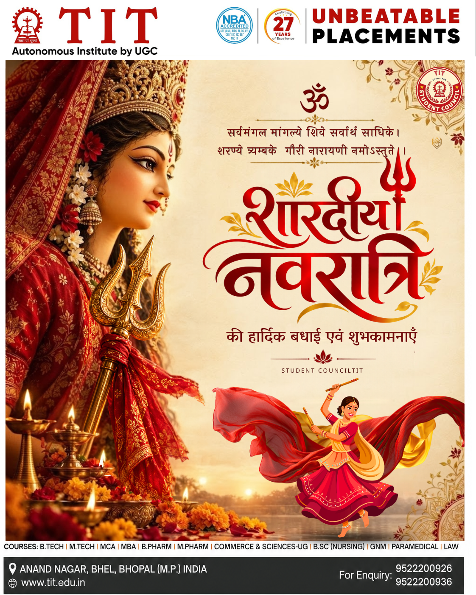

# 👋 Hi, I'm Alok Raj

### 💻 Java Developer | Full-Stack Developer | SAP ABAP Learner | 🎨 Poster Designer

  
  

---

## 👨‍💻 About Me

Hi! I'm **Alok Raj**, a Computer Science and Engineering student at **Technocrats Institute of Technology (TIT), Bhopal**.

I'm passionate about software development, programming, creative design, and emerging technologies. I enjoy combining technical knowledge with creativity to develop useful applications and engaging digital experiences.

- 💻 Strengthening my skills in **Java, C++, and Data Structures & Algorithms**.
- 🌐 Exploring **Full-Stack Web Development** with React, Node.js, and MongoDB.
- ⚙️ Learning **SAP ABAP**, from basic program structure to internal tables and practical business programming.
- 🎨 Designing posters, festival creatives, and social media graphics, primarily using **Canva**.
- 🖌️ Exploring **Figma** for UI/UX design and interface prototyping.
- 🏛️ Contributing to the digital presence and creative initiatives of **Student Council TIT**.
- 🤝 Interested in collaboration, open-source projects, and continuous learning.

> 💡 My goal is to combine programming, design, and problem-solving to create meaningful digital experiences.

---

## 🎯 Current Focus

- 🌱 Improving Java, DSA, and problem-solving skills.
- 🌐 Building responsive and user-friendly web applications.
- ⚙️ Practicing SAP ABAP fundamentals and exploring enterprise development.
- 🎨 Creating professional posters and social media content using Canva.
- 🧩 Improving UI/UX design skills with Figma.
- 🚀 Developing practical projects and contributing to collaborative initiatives.
- 🤝 Exploring open-source and development opportunities.

---

## 🛠️ Tech Stack & Tools

### 👨‍💻 Programming Languages

  

### 🌐 Frontend Development

  

### ⚙️ Backend Development

  

### 🗄️ Databases

  

### 🏢 SAP Technologies

  
  

- ABAP program structure and syntax
- Data types, variables, and constants
- `WRITE`, `IF`, `ELSEIF`, and `ELSE`
- `DO` and `WHILE` loops
- Structures, internal tables, and work areas

### 🎨 Design & Creative Tools

  

**My design interests:**
- 🎨 Poster design and social media creatives
- 🪔 Festival posters and cultural event graphics
- 🏛️ College branding and promotional designs
- 🧩 UI/UX design and visual hierarchy
- ✨ Typography, composition, and color harmony

---

## 🚀 Featured Projects

### 🌐 1. Student Council TIT Website

A website project created to present Student Council information, activities, initiatives, and organizational details.

**Highlights**
- Student Council's digital presence
- Website design and user experience
- Responsive web development
- Student communication and engagement

  
  

### ⚙️ 2. SAP ABAP Basics

A beginner-friendly learning repository for SAP ABAP notes, program structures, syntax, and practical examples.

**Topics**
- Variables and data types
- Output statements
- Conditional statements
- Loops and control flow
- Structures and internal tables

### 💻 3. Full-Stack Development

Exploring web applications using modern frontend and backend technologies.

**Focus:** React, Node.js, Express, MongoDB, responsive interfaces, and REST APIs.

---

## 🎨 My Creative Portfolio

### 🖌️ Poster Design | Canva & Figma

Design is another important part of my journey. I primarily use **Canva** to create posters for Student Council TIT's social media, festivals, tributes, and student activities. I also explore Figma for interface and UI/UX design.

  

**Selected designs created for Student Council TIT**

<table>
  <tr>
    <td width="50%" align="center">
      
       
      <b>🙏 Ganesh Chaturthi</b>
       
      Devotional artwork with traditional elements and a festive golden atmosphere.
    </td>
    <td width="50%" align="center">
      
       
      <b>🌼 Nana Patekar Tribute</b>
       
      A tribute composition featuring portrait artwork, floral elements, and typography.
    </td>
  </tr>
  <tr>
    <td colspan="2" align="center">
      
       
      <b>🔱 Sharadiya Navratri</b>
       
      A festive design inspired by traditional Indian aesthetics and red-and-gold colors.
    </td>
  </tr>
</table>

### 💡 My Creative Process

- 🎯 Understand the purpose and audience.
- 🎨 Choose suitable colors, typography, and composition.
- 🖌️ Create the design primarily in Canva.
- 🧩 Refine layout, visual hierarchy, and readability.
- 📱 Prepare graphics for social media publishing.

  
  

---

## 📊 GitHub Analytics

 

 

---

## 🧩 Coding Profiles

I enjoy practicing programming, improving logical thinking, and learning through hands-on coding.

---

## 🌱 Areas of Interest

`Java Development` · `DSA` · `Full-Stack Development` · `SAP ABAP` · `Backend Development` · `Poster Design` · `Canva` · `Figma` · `UI/UX` · `Open Source`

---

## 👥 Leadership & Activities

### 🎓 Academic Council Officer — Student Council, TIT, Bhopal

I contribute to student council initiatives, website management, creative design, digital communication, and student activities.

**Areas of involvement**
- Website and digital initiatives
- Student Council social media content
- Poster design and visual communication
- Event coordination and student engagement
- Teamwork and collaboration

---

## 🌐 Connect With Me

  

### 💫 Learn • Code • Design • Build • Innovate

*Combining technology and creativity to build meaningful experiences.*

**⭐ Thanks for visiting my GitHub profile!**

